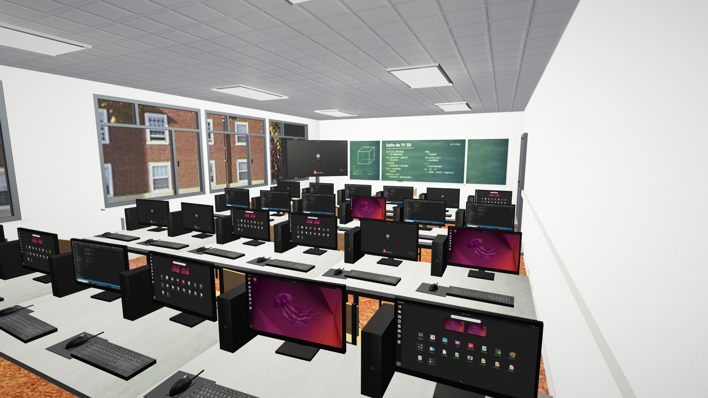
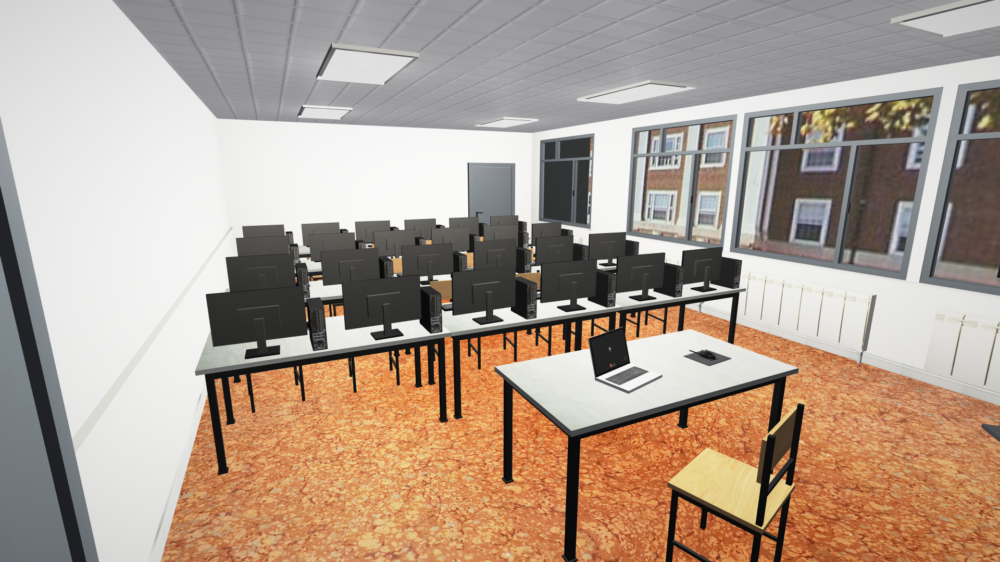
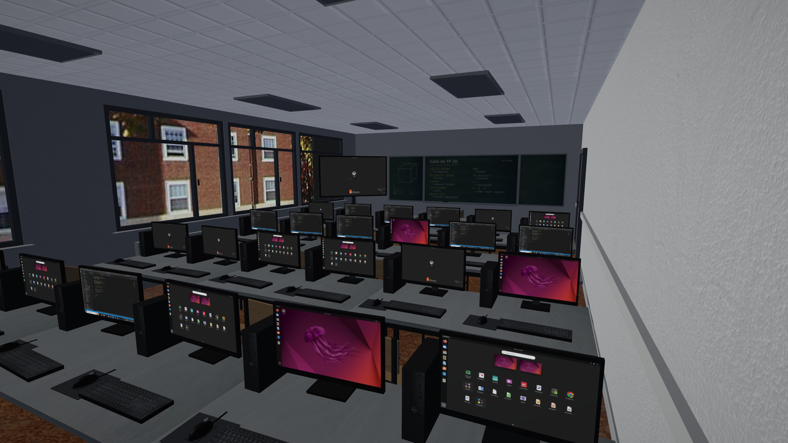
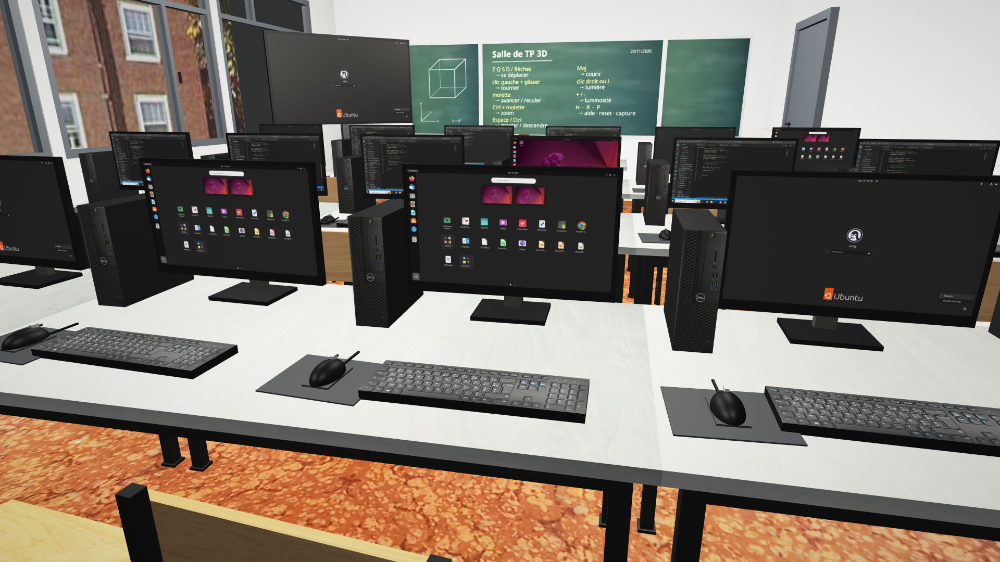
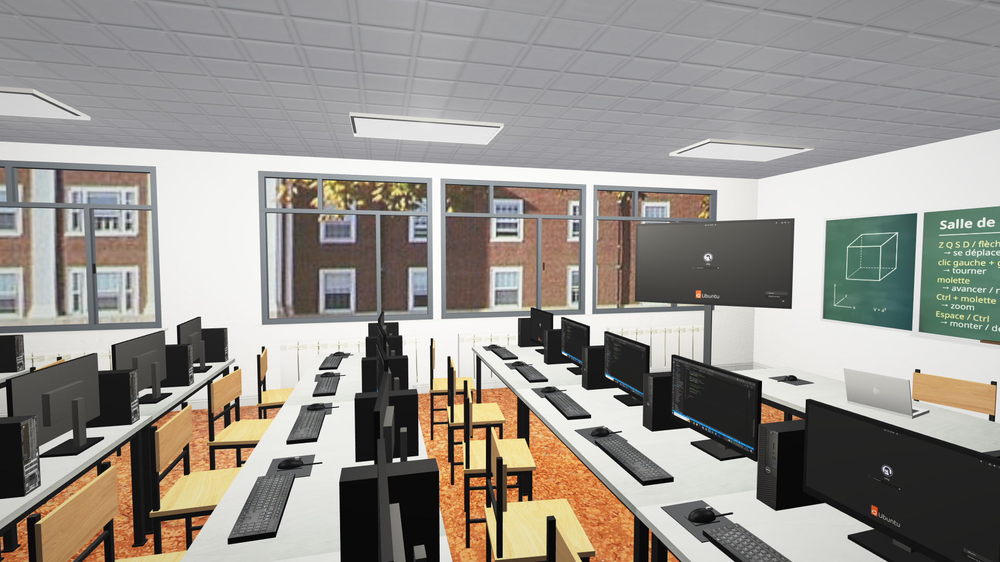

# Salle de TP en 3D — Processing

<p align="center">
  
  
</p>
<p align="center">
  
  
  
</p>

# Description du projet

Modélisation 3D interactive d'une salle de travaux pratiques (TP) réalisée avec
[Processing](https://processing.org) (moteur P3D). La salle contient 4 rangées de
tables avec 24 postes complets (écran, unité centrale, clavier, souris, chaise), le
bureau de l'enseignant avec un ordinateur portable, un grand écran sur pied, des
tableaux, deux portes, quatre fenêtres donnant sur l'extérieur et des radiateurs.

Le rendu utilise des textures, un éclairage par pixel (Blinn-Phong) avec six
plafonniers atténués, la lumière du jour qui entre par les fenêtres, des écrans
et plafonniers lumineux, et une compression douce des hautes lumières.

## Lancer le projet

Ouvrir `ProjetFinal.pde` dans Processing 4 et lancer le sketch, ou en ligne de commande :

```bash
processing-java --sketch=/chemin/vers/ProjetFinal --run
```

> Le dossier du sketch doit s'appeler `ProjetFinal` (nom du fichier principal).

## Commandes

| Action | Touche |
| --- | --- |
| Se déplacer | `Z Q S D`, `W A S D` ou flèches |
| Tourner | glisser avec le clic gauche |
| Avancer / reculer | molette de la souris |
| Zoom | `Ctrl` + molette |
| Monter / descendre | `Espace` / `Ctrl` |
| Courir | `Maj` |
| Allumer / éteindre la lumière | clic droit ou `L` |
| Luminosité | `+` / `-` |
| Afficher / masquer l'aide | `H` |
| Réinitialiser la caméra | `R` |
| Capture d'écran (dossier `captures/`) | `P` |

Les déplacements sont fluides, indépendants du nombre d'images par seconde,
acceptent plusieurs touches simultanées, et la caméra ne traverse plus les murs.

## Structure du code

| Fichier | Rôle |
| --- | --- |
| `ProjetFinal.pde` | Point d'entrée : fenêtre, boucle de rendu, entrées clavier/souris, aide à l'écran |
| `MeshBuilder.pde` | Construit la géométrie : chaque pavé est transformé puis ajouté au lot de son matériau |
| `Materiaux.pde` | Matériaux (texture, teinte, répétition, émission, brillance), créés une seule fois |
| `Textures.pde` | Registre des textures : chargement unique, réduction des images trop grandes |
| `Salle.pde` | Assemblage de la salle : murs, ouvertures, rangées, bureau de l'enseignant |
| `Mobilier.pde` | Objets : table, chaise, écran, UC, clavier, souris, portable, radiateur, porte, fenêtre, tableaux |
| `Eclairage.pde` | Plafonniers, lumière du jour, allumage/extinction |
| `CameraFPS.pde` | Caméra à la première personne |
| `Capture.pde` | Mode capture qui régénère les images de ce README |
| `Data/shaders/` | Shader d'éclairage par pixel |

### Optimisation

Toute la géométrie statique (≈ 11 600 faces) est fusionnée en **35 lots, un par
matériau**, construits une seule fois au démarrage. L'ancienne version créait un
`PShape` par pavé (plusieurs milliers d'objets et d'appels de dessin). Les faces
invisibles (contre le sol ou les murs) ne sont pas générées, et les textures de
plus de 2048 px sont réduites au chargement.

### Régénérer les captures

```bash
processing-java --sketch=/chemin/vers/ProjetFinal --run --capture
```

Les images `Data/images/demo1.png` à `demo5.png` sont réécrites en 1920×1080, puis le programme se ferme.

---

# Project Description

Interactive 3D model of a computer lab built with Processing (P3D). The room holds
4 rows of desks with 24 complete workstations, the teacher's desk with a laptop,
a large display on a stand, boards, two doors, four windows with an outside view,
and radiators. Rendering uses textures, per-pixel Blinn-Phong lighting with six
attenuated ceiling lights plus daylight, and emissive screens and lamps.

**Controls:** `ZQSD`/`WASD`/arrows to move, left-drag to look around, mouse wheel to
move forward/back, `Ctrl` + wheel to zoom, `Space`/`Ctrl` up/down, `Shift` to run,
right click or `L` to toggle lights, `+`/`-` brightness, `H` help, `R` reset, `P` screenshot.

All static geometry is merged into one batch per material (35 draw batches),
built once at startup.
